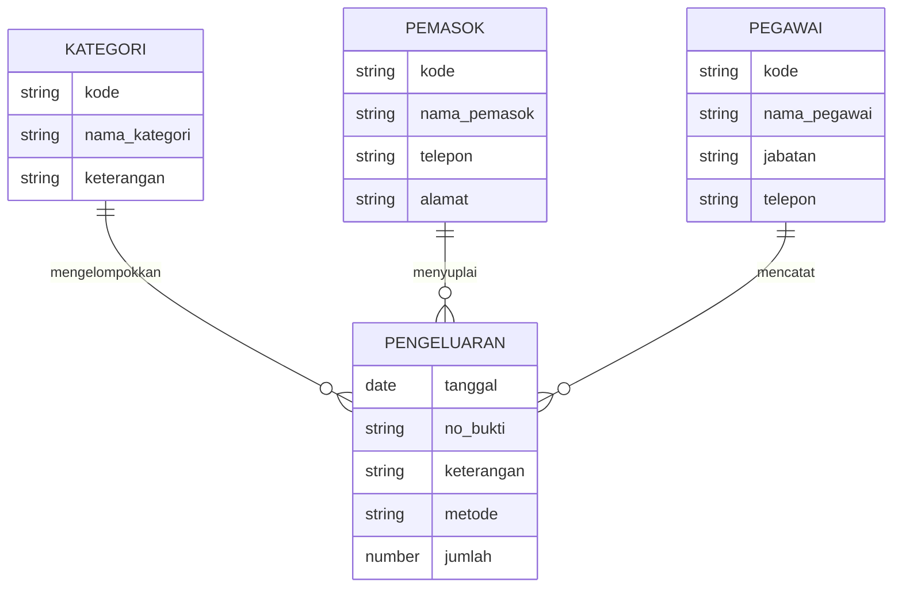

# Deli Catering: Sistem Pengeluaran Kas

Sistem informasi keuangan berbasis web untuk mencatat dan memantau **pengeluaran kas** usaha catering. Data disimpan di **Supabase** dan terhubung antar empat entitas: **Kategori, Pemasok, Pegawai, dan Pengeluaran**.

**Akses aplikasi:** https://nmrlgn-ayu.github.io/DELICIACATERING/

---

## Gambaran Umum

Aplikasi ini membantu pemilik atau bagian keuangan Deli Catering menjawab pertanyaan seperti:

- Berapa total uang yang sudah keluar, dan berapa bulan ini?
- Kategori biaya apa yang paling besar?
- Pembelian dari pemasok mana yang paling sering?
- Siapa pegawai yang mencatat atau bertanggung jawab atas suatu transaksi?

## Halaman dan Fitur

| Halaman | Fungsi |
|---|---|
| **Dashboard** | Ringkasan total pengeluaran, jumlah transaksi, jumlah pemasok, pengeluaran bulan ini, rekap per kategori, dan lima transaksi terbaru |
| **Transaksi Pengeluaran** | Tambah, ubah, dan hapus pengeluaran kas, dengan filter berdasarkan kategori |
| **Kategori** | Kelola kategori pengeluaran beserta jumlah transaksi tiap kategori |
| **Pemasok** | Kelola data pemasok bahan dan kebutuhan catering (telepon, alamat) |
| **Pegawai** | Kelola data pegawai (jabatan, telepon) yang terkait dengan transaksi |

## Relasi Antar Entitas

Setiap transaksi pengeluaran terhubung ke satu kategori, satu pemasok, dan satu pegawai.



> Diagram ini disusun dari kolom yang tampil di aplikasi. Sesuaikan nama kolom dengan skema tabel Supabase yang sebenarnya.

## Struktur Proyek

```
DELICIACATERING/
├── index.html      # mengalihkan otomatis ke frontend/ (untuk GitHub Pages)
├── frontend/
│   └── index.html  # antarmuka aplikasi
└── README.md
```

Tambahkan berkas lain (misalnya folder `css/`, `js/`, atau `backend/`) ke diagram di atas jika ada di repositori Anda.

## Teknologi

- **Antarmuka:** HTML, CSS, dan JavaScript
- **Basis data:** Supabase (PostgreSQL)
- **Hosting:** GitHub Pages

## Cara Menjalankan

1. **Siapkan Supabase.** Buat proyek, lalu buat empat tabel (kategori, pemasok, pegawai, pengeluaran) dengan relasi foreign key dari pengeluaran ke tiga tabel lainnya.
2. **Isi konfigurasi.** Masukkan *Project URL* dan *anon key* dari **Project Settings → API** ke berkas JavaScript aplikasi.
3. **Buka aplikasi.** Jalankan `frontend/index.html` di browser, atau aktifkan **Settings → Pages** di GitHub agar tersedia online.

Jika dashboard menampilkan status "Menghubungkan ke Supabase…" terus-menerus, periksa URL, anon key, dan kebijakan RLS pada tabel.

## Keamanan

- Gunakan hanya **anon key** di kode frontend. Jangan memasukkan `service_role` key.
- Aktifkan **Row Level Security** pada semua tabel dan atur kebijakan akses sesuai kebutuhan, karena data ini bersifat keuangan.

## Pengembangan Lanjutan

- Login pengguna dan pembatasan akses berdasarkan peran
- Ekspor laporan ke Excel atau PDF
- Filter berdasarkan rentang tanggal dan pemasok
- Grafik pengeluaran per bulan
